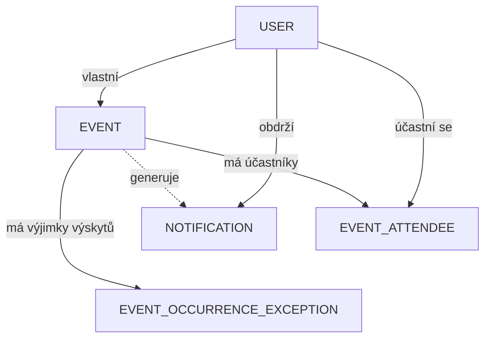

# Návrh webové aplikace CalendarWebApp

Cílem projektu je webová aplikace pro správu kalendáře událostí. Uživatel si bude moct vytvářet vlastní události, přehledně je zobrazovat v měsíčním kalendáři, plánovat opakované události, zvát další uživatele jako účastníky a přijímat notifikace (pozvánky, změny událostí, připomínky).

## Funkční požadavky

| Kód  | Požadavek                                                                                                                                      |
| ---- | ---------------------------------------------------------------------------------------------------------------------------------------------- |
| FP1  | Registrace nového uživatele a přihlášení/odhlášení přes ASP.NET Core Identity                                                                  |
| FP2  | Dvě role: `Admin` a `User`; automatické přiřazení role při registraci                                                                          |
| FP3  | Měsíční kalendář s přehledem událostí přihlášeného uživatele, navigace po měsících                                                             |
| FP4  | Vytvoření události (název, popis, začátek a konec, celodenní, místo, barva, připomínka)                                                        |
| FP5  | Editace a mazání vlastních událostí, detail události se seznamem účastníků a jejich stavů                                                      |
| FP6  | Opakované události (pravidlo opakování denně/týdně/měsíčně s datem ukončení)                                                                   |
| FP7  | Výjimky jednotlivých výskytů opakované události — posun, editace nebo zrušení jedné konkrétní instance bez ovlivnění série                     |
| FP8  | Pozvání registrovaných uživatelů k události, pozvaný uživatel může pozvánku přijmout/zamítnout/zvážit                                          |
| FP9  | Notifikace (pozvánka do události, změna události, připomínka, vlastní) s počtem nepřečtených a označením jako přečtené                         |
| FP10 | Uživatel vidí pouze své události (vlastní + ty, na které je pozván); dotazy budou vždy filtrovány podle přihlášeného uživatele                 |
| FP11 | Area `Admin` — správa všech položek databáze: uživatelé (výpis, vytvoření, editace, mazání, role), všechny události včetně editace, notifikace |
| FP12 | Admin může spravovat data uživatelů                                                                                                            |
| FP13 | Serverová validace všech formulářů, klientská validace a vlastní validační atributy                                                            |
| FP14 | Responzivní uživatelské rozhraní (Bootstrap 5) použitelné na mobilu i desktopu                                                                 |

## Nefunkční požadavky

| Kód  | Požadavek                                                                                                |
| ---- | -------------------------------------------------------------------------------------------------------- |
| NFP1 | Aplikace bude postavena na ASP.NET Core MVC (.NET 9), objektově, s využitím MVC vzoru                    |
| NFP2 | Vícevrstvá architektura: Presentation, Application, Infrastructure, Domain                               |
| NFP3 | Ve webovém projektu nesmí být žádný SQL kód; veškerá funkcionalita bude realizována a volána přes služby |
| NFP4 | Presentation vrstva nesmí používat Infrastructure přímo (kromě konfigurace); controllery budou „tenké“   |
| NFP5 | Minimálně 5 entit/ViewModelů/DTO (mimo entity EF Core a Identity) a alespoň jedna relace přes cizí klíč  |
| NFP6 | Časové údaje se budou ukládat v UTC, zobrazovat v lokálním čase                                          |
| NFP7 | Databáze MySQL 8, front-end Bootstrap 5 + jQuery                                                         |

## Návrh architektury

Pravidla vrstvení:

- **Domain** — čisté entity, enumy a validační atributy, žádné závislosti na dalších vrstvách ani na EF Core.
- **Infrastructure** — `CalendarDbContext` (EF Core), konfigurace entit Fluent API, migrace, seed dat.
- **Application** — veškerá business logika v aplikačních službách; controllery budou služby pouze volat. ViewModely/DTO pro přenos dat do Presentation vrstvy.
- **Web** — controllery, Razor views, Area `Admin`; přístup k datům výhradně přes služby z Application vrstvy.

## Návrh entit a databáze

### Přehled entit

| Entita                     | Účel                                                                |
| -------------------------- | ------------------------------------------------------------------- |
| `Event`                    | Událost v kalendáři: vlastník, čas, místo, opakování                |
| `EventAttendee`            | Vazební entita M:N mezi událostí a účastníkem + stav a role účasti  |
| `Notification`             | Notifikace pro uživatele, volitelně svázaná s událostí              |
| `EventOccurrenceException` | Výjimka jednoho výskytu opakované události (override položek série) |
| `User`                     | Uživatel, role, přihlašovací údaje                                  |

### ER diagram

### Popis návrhu

- **Event ↔ User** — každá událost má jednoho vlastníka (`OwnerId`); vlastník má v `EventAttendee` roli `Owner`.
- **Event ↔ User (M:N)** — vazební entita `EventAttendee` s kompozitním PK (`EventId`, `UserId`). Stav pozvánky nese enum `AttendeeStatus` (Invited/Accepted/Declined/Tentative), roli enum `AttendeeRole` (Owner/Participant).
- **Notification** — patří uživateli (`UserId`), volitelně odkazuje na událost (nullable FK `EventId`). Typ zprávy nese enum `NotificationType` (EventInvite/EventUpdate/Reminder/Custom).
- **EventOccurrenceException** — výjimka jednoho výskytu opakované události: řádek existuje jen pro výskyty odlišné od série; `null` = dědění z hlavní události, `IsCancelled` = zrušený výskyt, `OriginalDate` = původní datum výskytu v sérii.

## Návrh služeb a ViewModelů

| Služba (interface)        | Odpovědnost                                                                                |
| ------------------------- | ------------------------------------------------------------------------------------------ |
| `IEventAppService`        | CRUD událostí, načtení pro kalendář, pozvání účastníků, výjimky výskytů, kontrola přístupu |
| `IRecurrenceAppService`   | Parsování pravidla opakování, generování výskytů v zobrazeném rozsahu                      |
| `INotificationAppService` | Vytváření notifikací, nepřečtené, výpis, označení jako přečtené                            |
| `IAccountAppService`      | Registrace, přihlášení, odhlášení (Identity)                                               |
| `IUserAppService`         | Správa uživatelů pro admina (výpis, vytvoření, editace, mazání, role)                      |

ViewModely/DTO:

- `RegisterViewModel`, `LoginViewModel` — autentizace,
- `EventCreateViewModel`, `EventEditViewModel` — formuláře událostí,
- `MonthlyCalendarViewModel`, `CalendarDayViewModel` — měsíční kalendář,
- `AdminEventCreateViewModel` — událost vytvořená adminem za jiného uživatele,
- `UserListViewModel`, `UserCreateViewModel`, `UserWithRoleDto` — správa uživatelů.

